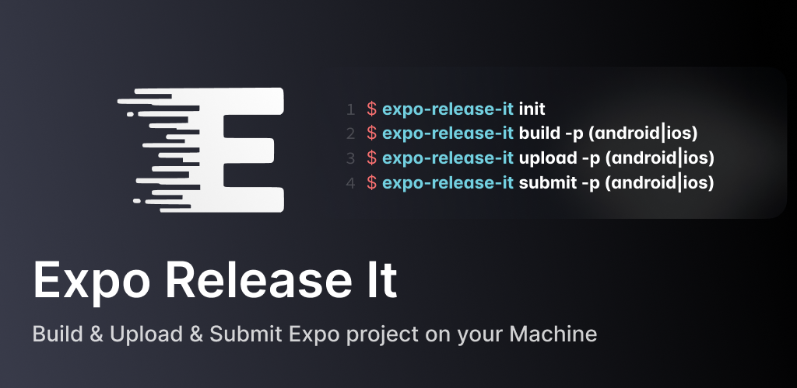

# Expo Release It ⚡️



Opinionated Expo CICD workflow CLI for building & uploading & submitting Expo projects on your machine

# Documentation

Visit our [Documentation Site](https://expo-release-it.mjstudio.net)

# Features

- 🎉 No **EAS**
- 🩵 No headaches when understanding and managing **keys and credentials**
- 🧩 Manage and sync **store metadata** easily
- 🌍 Works with [Expo CNG](https://docs.expo.dev/workflow/continuous-native-generation/)
- 📦 Build artifacts **locally** (`apk`, `aab`, `ipa`)
- 🚀 Upload artifacts to Google Play Console Internal Testing Track and iOS TestFlight
- ✅ Submit releases for store review

# Support

| Area                | Supported scope                                                                               |
| ------------------- | --------------------------------------------------------------------------------------------- |
| Workflow            | Expo CNG only; native customizations belong in app configuration or config plugins            |
| Expo / React Native | Expo SDK 52 and newer with each SDK's official React Native version; no upper SDK version cap |
| Ruby                | MRI Ruby 3.3, 3.4, or 4.0; latest Ruby 3.3 patch recommended                                  |
| Managed tools       | Bundler 2.5.22, Fastlane 2.227.1, and CocoaPods 1.16.2 for iOS builds                         |
| Platforms           | macOS for iOS and Android; Linux for Android                                                  |

CI currently checks Ruby 3.3 and 4.0 on macOS/Linux, plus SDK 58 Android AAB and unsigned iOS builds with Xcode 27.0. Ruby 3.4, SDK 57 examples, and APK builds remain available for manual verification. The CI matrix is a verification baseline, not the full support range.

Prepare Ruby and the pinned Bundler yourself; the CLI installs its managed gems in `expo-release-it/.ruby`. See [Ruby setup and dependency maintenance](https://expo-release-it.mjstudio.net/ruby).

Credentials are encrypted by default in `expo-release-it/credentials.enc.json`. Every command, including `init`, `bump`, and unsigned builds, requires `EXPO_RELEASE_IT_ENCRYPTION_KEY` from your environment, `.env`, or GitHub Actions secrets. A missing key stops the command before any project changes or legacy migration. Existing commands handle encryption and temporary decryption automatically once the key is provided. See [Credential encryption and migration](https://expo-release-it.mjstudio.net/security).

The CLI owns release orchestration, integration with Expo-generated projects, and its managed Ruby toolchain. Prepare a toolchain supported by your project's Expo and React Native versions. Upstream native dependency or compiler incompatibilities are outside this library's scope; it does not patch Expo/RN, Pods source, or Xcode to repair them.

# Development

Install [mise](https://mise.jdx.dev/getting-started.html), then run from the repository root:

```sh
mise trust
mise install node pnpm
mise exec -- pnpm install --frozen-lockfile
mise exec -- pnpm run t
```

Local development and CI use the Node.js and pnpm versions pinned in `mise.toml`.

# Licenses

- See [LICENSE](/LICENSE)

---

<p align="center">
  <a href="https://mjstudio.net/">
    
  </a>
  <p align="center">
    Built and maintained by <a href="https://mjstudio.net/">MJ Studio</a>.
  </p>
</p>
